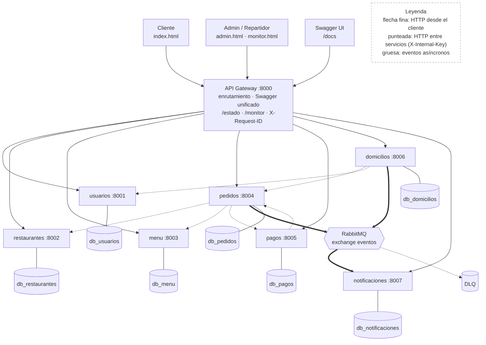
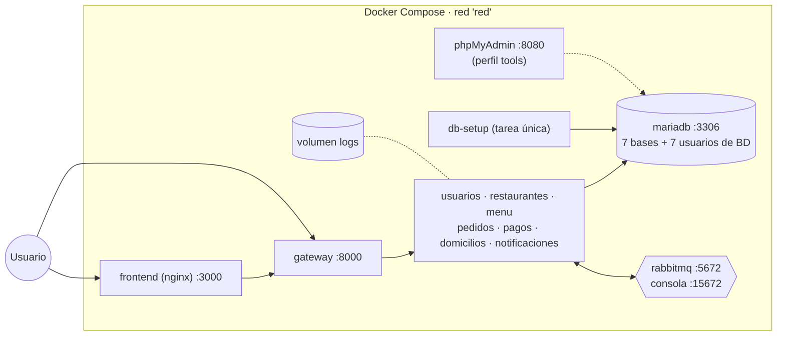
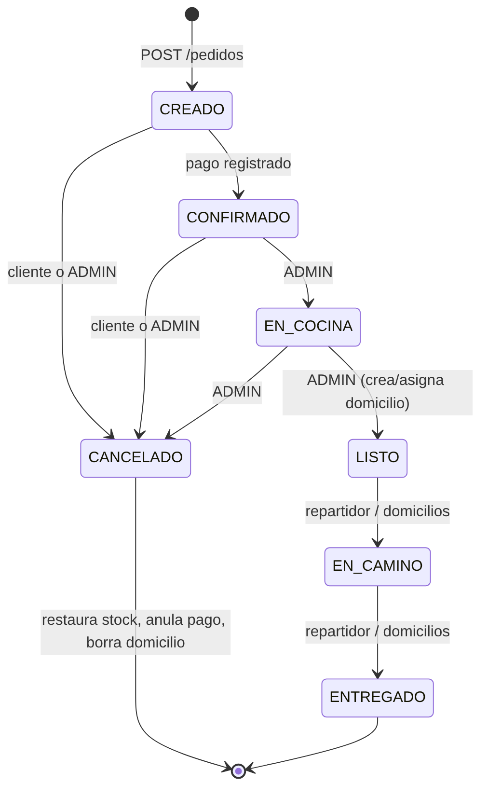

# 01 · Arquitectura

## Problema y objetivo
Un restaurante pequeño no puede escalar ni evolucionar con un sistema monolítico donde un fallo (por ejemplo en notificaciones) tumba la toma de pedidos.
**Objetivo:** gestionar restaurantes, menús, clientes, pedidos, pagos y domicilios como servicios independientes, cada uno con su base de datos,
comunicados por API y por eventos, de modo que un pedido se complete aunque un servicio secundario falle.

## Vista general

* **Gateway (8000):** única puerta de entrada. Reenvía `/{servicio}/{ruta}` al servicio correspondiente, conserva `Authorization` y `X-Request-ID`,
  **nunca** reenvía la clave interna y publica el Swagger unificado (`/docs`).
* **7 microservicios FastAPI**, cada uno con responsabilidad única (ver tabla en el README) y su propia base de datos.
* **RabbitMQ:** transporta los eventos de dominio de `pedidos` y `domicilios` hacia `notificaciones`.
* **Frontend** estático (HTML/CSS/JS) que solo habla con el gateway.

## Responsabilidades (límites de cada servicio)
| Servicio | Es dueño de | No hace |
|---|---|---|
| usuarios | cuentas, roles, hash de contraseña, disponibilidad del repartidor | no conoce pedidos |
| restaurantes | datos del restaurante y su estado activo | no maneja productos |
| menu | productos, precios, stock | no conoce pedidos; solo descuenta/repone cuando se le ordena |
| pedidos | pedido, detalle, estado, compensaciones | no cobra ni asigna repartidor: los llama |
| pagos | registro y estado del pago (monto leído del pedido, nunca del cliente) | no cambia otros datos salvo pedir `CONFIRMADO` |
| domicilios | asignación, bolsa de pedidos, avance del reparto | no lee la base de usuarios: pregunta por HTTP |
| notificaciones | avisos por usuario, lectura | no inicia nada: solo reacciona a eventos |

## Despliegue

`docker-compose.yml` levanta MariaDB, RabbitMQ, una tarea `db-setup` (bases, tablas, usuarios de BD y datos demo),
los 7 servicios + gateway con *healthchecks* (`/health`), el frontend (nginx) y, opcionalmente, phpMyAdmin.
Los servicios esperan a que la base y el broker estén sanos (`depends_on: service_healthy`).
Cada servicio se conecta con **su propio usuario de BD** (`svc_<servicio>`), que solo puede operar sobre **su** base.

## Máquina de estados del pedido

`EN_CAMINO` y `ENTREGADO` solo los puede fijar el servicio de domicilios (rol interno `SISTEMA`); así el cliente o un administrador no pueden saltarse el reparto.
Cada transición usa un `UPDATE … WHERE estado = <anterior>` atómico, por lo que dos peticiones simultáneas no pueden aplicar la misma transición dos veces.

## Compensaciones (consistencia sin transacciones distribuidas)
Al crear un pedido: se valida el restaurante → se reserva stock de forma atómica (`stock >= cantidad`) → se guarda el pedido en una transacción → se cobra.
Si algo falla después de reservar, se **restaura el stock** y se cancela el pedido. Al cancelar: se restaura stock, se anula el pago y se elimina el domicilio.
