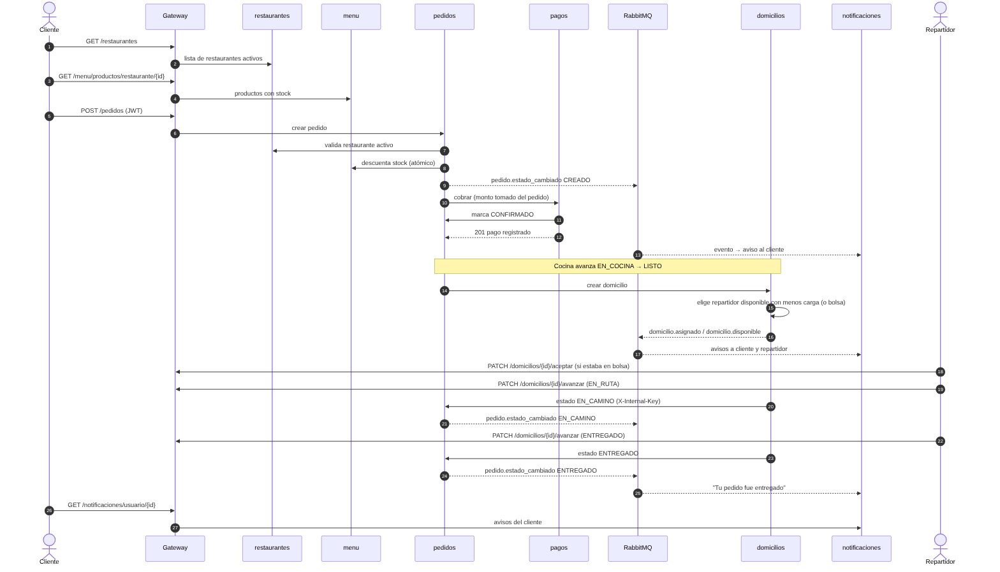

# 02 · Comunicación entre servicios

## 1. APIs REST documentadas
Todos los servicios exponen OpenAPI. El gateway publica **un Swagger unificado** en <http://localhost:8000/docs> (61 operaciones, rutas prefijadas por servicio,
botón *Authorize* para el JWT). Los contratos exportados están en [`openapi/`](openapi/) (`python exportar_openapi.py`).

Formato de error uniforme en todo el sistema: `{"detail": "mensaje"}` (y `request_id` en errores 500).

| Código | Cuándo |
|---|---|
| 400 | Dato inválido o regla de negocio (stock insuficiente, transición no permitida) |
| 401 | Sin token, token inválido o vencido |
| 403 | El rol no tiene permiso |
| 404 | El recurso no existe |
| 409 | Conflicto de estado (p. ej. pedido ya aceptado por otro repartidor) |
| 422 | Validación del cuerpo/parámetros (FastAPI) |
| 429 | Demasiados intentos de login (bloqueo temporal) |
| 502/503 | Un servicio dependiente falló o no está disponible (el gateway responde 503 si el destino no contesta) |

## 2. Llamadas síncronas (HTTP) y por qué
Se usan cuando el que llama **necesita la respuesta para decidir**:
* `pedidos → restaurantes` (¿está activo?), `pedidos → menu` (reservar stock), `pedidos → pagos` (cobrar).
* `pagos → pedidos` (monto real del pedido y marcarlo `CONFIRMADO`), `domicilios → pedidos` (cambiar estado), `domicilios → usuarios` (repartidores disponibles).

Reglas: *timeout* de 5 s, llamadas firmadas con `X-Internal-Key`, el mismo `X-Request-ID` viaja en toda la cadena y los fallos se registran con ese id.

## 3. Eventos asíncronos (RabbitMQ) y por qué
Se usan cuando **el emisor no debe esperar ni depender** de quien reacciona: avisar al cliente/repartidor.
Un pedido nunca falla ni se demora porque `notificaciones` esté caído.

| Evento (routing key) | Publica | Quién reacciona |
|---|---|---|
| `pedido.estado_cambiado` | pedidos | notificaciones → aviso al cliente |
| `domicilio.asignado` | domicilios | notificaciones → aviso al repartidor y al cliente |
| `domicilio.disponible` | domicilios | notificaciones → aviso a repartidores disponibles (pedido en bolsa) |
| `domicilio.aceptado` | domicilios | notificaciones → aviso al cliente |

Topología: exchange `eventos` (topic, durable) → cola durable `notificaciones` (bindings `pedido.*`, `domicilio.*`) con *dead-letter* hacia `eventos.dlx` → cola `notificaciones.dlq`.

Garantías implementadas (y probadas en [`tests/resiliencia_rabbitmq.py`](../tests/resiliencia_rabbitmq.py)):
* **Mensajes persistentes** + *publisher confirms* (`delivery_mode=2`, `confirm_delivery`).
* **Ack manual**: si el procesamiento falla, `nack(requeue=False)` envía el mensaje a la **DLQ**; no se pierde ni se reintenta en bucle.
* **Idempotencia**: índice único `(evento_id, usuario_id)`; reprocesar el mismo evento no duplica avisos.
* **Respaldo HTTP + circuit breaker**: si RabbitMQ no está configurado o no responde, el publicador pasa 15 s a `POST /eventos` de notificaciones y vuelve a AMQP solo.
* **Reconexión automática** del consumidor y medición de la DLQ para el monitor.

## 4. Flujo obligatorio de la demostración

Cada recuadro de la demo corresponde a un paso numerado: restaurante (1-2) → menú (3-4) → pedido (5-9) → pago (10-12) → asignación de repartidor (14-17) →
cambio de estado (18-24) → notificación al cliente (13, 17, 25-27).

## 5. Asignación de repartidor
Al pasar a `LISTO` se busca entre los repartidores **disponibles** el que tenga menos domicilios activos. Si no hay ninguno, el pedido queda en la **bolsa**
(domicilio sin repartidor) y se publica `domicilio.disponible`; el primer repartidor disponible que acepte se queda con él (`UPDATE … WHERE repartidor_id IS NULL`, atómico: si dos aceptan a la vez, uno recibe 409).
