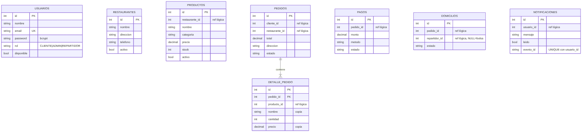

# 03 · Modelo de datos por servicio

Principio: **una base de datos por servicio, sin tablas compartidas y sin claves foráneas entre bases**.
Las referencias entre servicios (`cliente_id`, `producto_id`, …) son *referencias lógicas*: se validan por API, no por la base.
La única clave foránea real es `detalle_pedido → pedidos`, que vive dentro de `db_pedidos`.

| Base | Tabla | Campos clave | Notas |
|---|---|---|---|
| `db_usuarios` | `usuarios` | id, nombre, email (único), password (bcrypt), rol, disponible | rol: CLIENTE · ADMIN · REPARTIDOR |
| `db_restaurantes` | `restaurantes` | id, nombre, direccion, telefono, activo | baja lógica (`activo`) |
| `db_menu` | `productos` | id, restaurante_id, nombre, categoria, precio, stock, activo | stock descontado con `UPDATE … WHERE stock >= n` |
| `db_pedidos` | `pedidos` | id, cliente_id, restaurante_id, total, direccion, estado, created_at | índices por cliente y estado |
| `db_pedidos` | `detalle_pedido` | pedido_id (FK), producto_id, nombre, cantidad, precio | guarda **copia** del nombre y precio al comprar |
| `db_pagos` | `pagos` | id, pedido_id, monto, metodo, estado | PENDIENTE · PAGADO · FALLIDO · REEMBOLSADO |
| `db_domicilios` | `domicilios` | id, pedido_id, repartidor_id (NULL = bolsa), estado | ASIGNADO · EN_RUTA · ENTREGADO |
| `db_notificaciones` | `notificaciones` | id, usuario_id, mensaje, leido, evento_id | `UNIQUE (evento_id, usuario_id)` = idempotencia |

## Aislamiento verificado
* Con `SERVICE_DB_PASS` definido (modo Docker) `setup_db.py` crea 7 usuarios `svc_<servicio>` con permisos **SELECT, INSERT, UPDATE, DELETE solo sobre su base**.
  Probado: `svc_menu` recibe *access denied* al consultar `db_usuarios`.
* `domicilios` ya no lee `db_usuarios`: pide la lista de repartidores a `usuarios` por HTTP.
* Los datos copiados (nombre y precio en `detalle_pedido`) evitan consultar `menu` para mostrar pedidos históricos.

## Datos de demostración
`setup_db.py` crea 4 usuarios (admin, 2 repartidores, 1 cliente) y 3 restaurantes con productos. `python setup_db.py --reset` los recrea desde cero.
