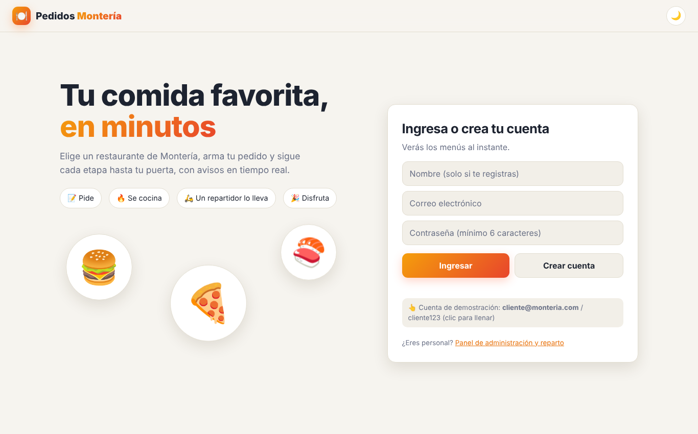
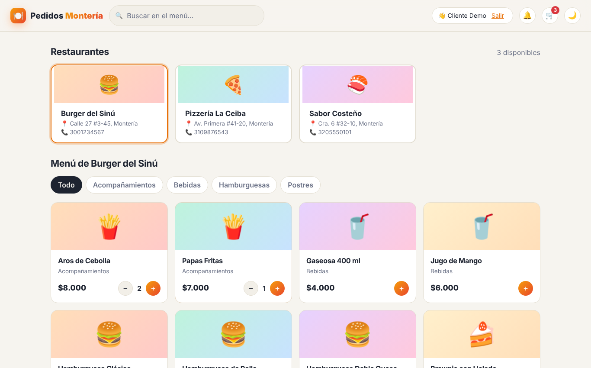
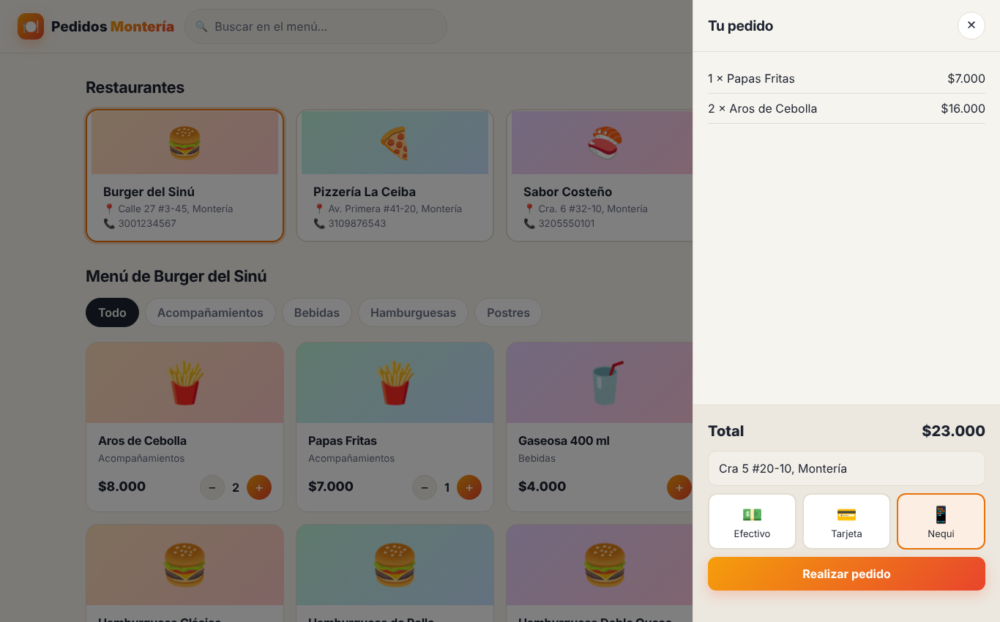
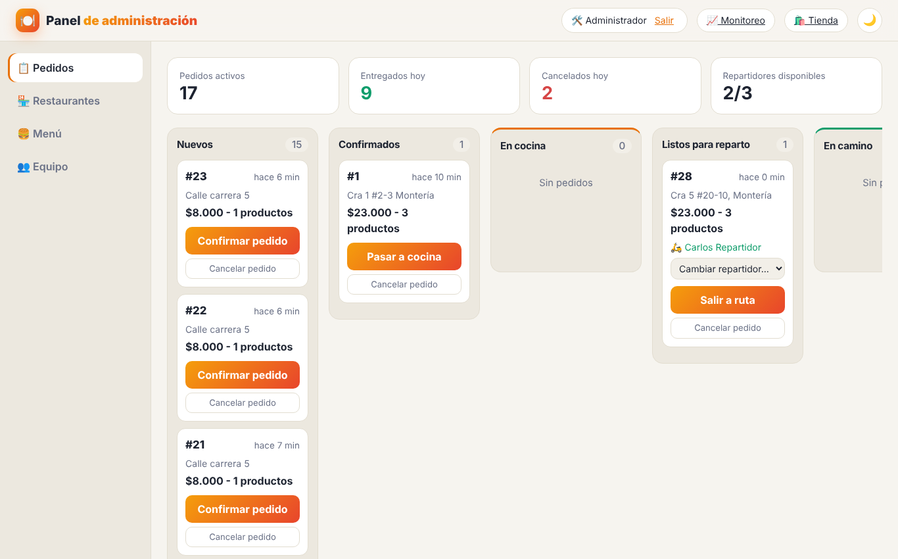
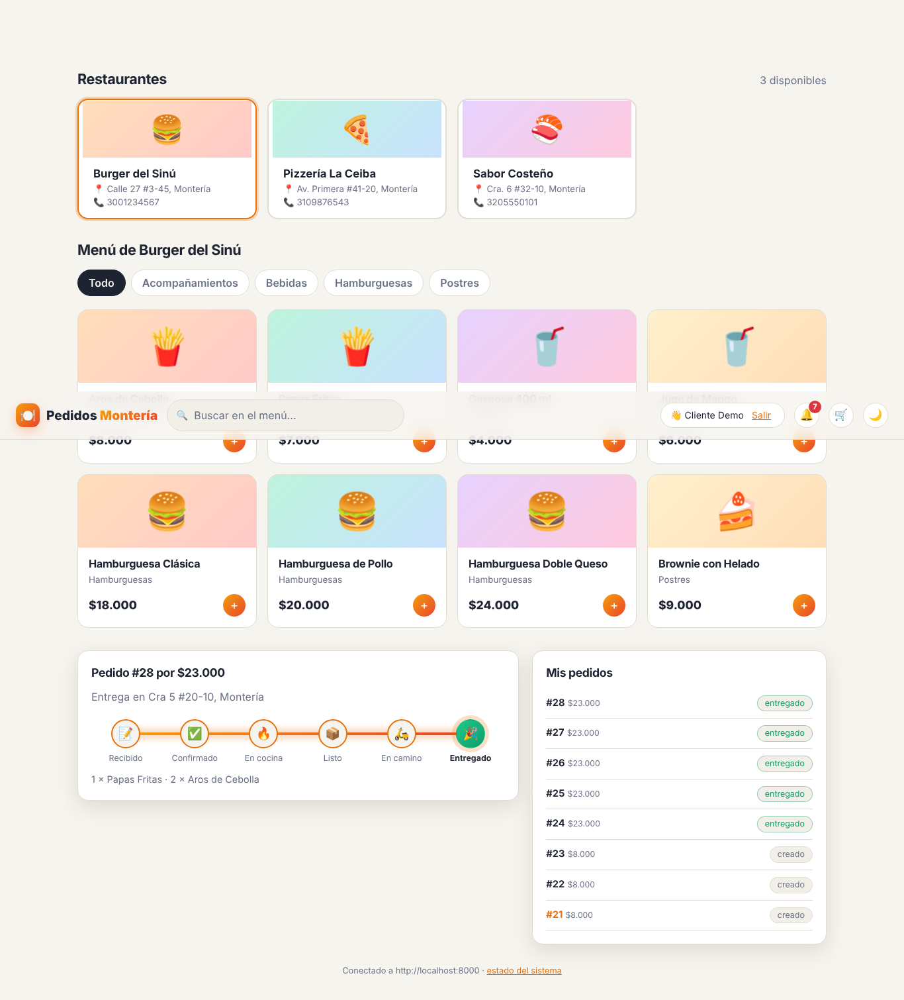
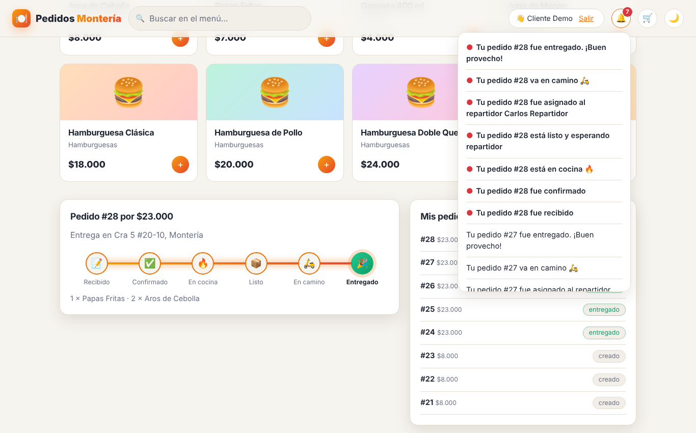
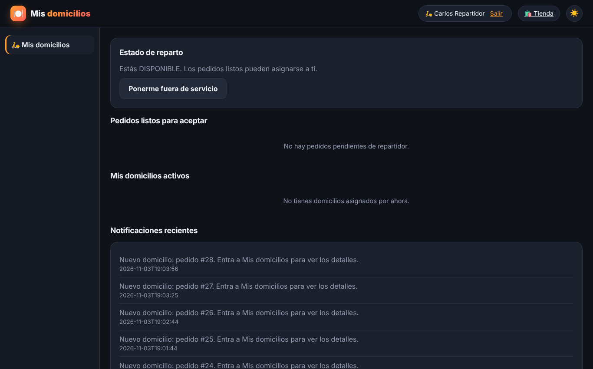
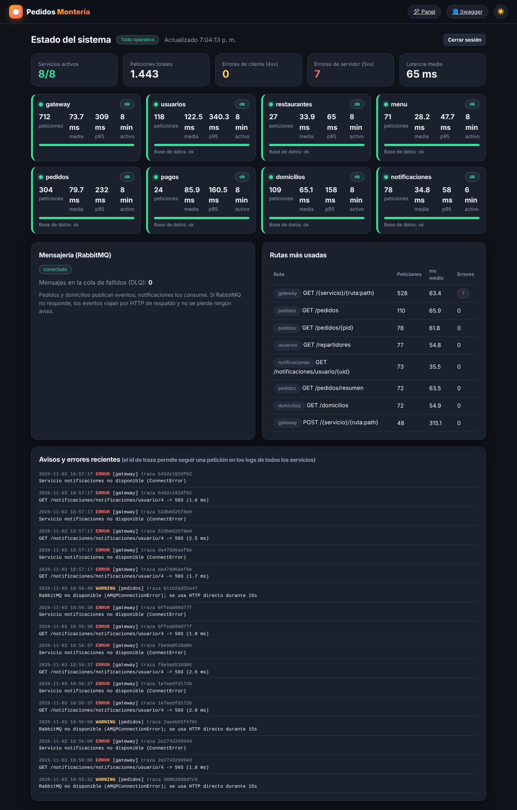
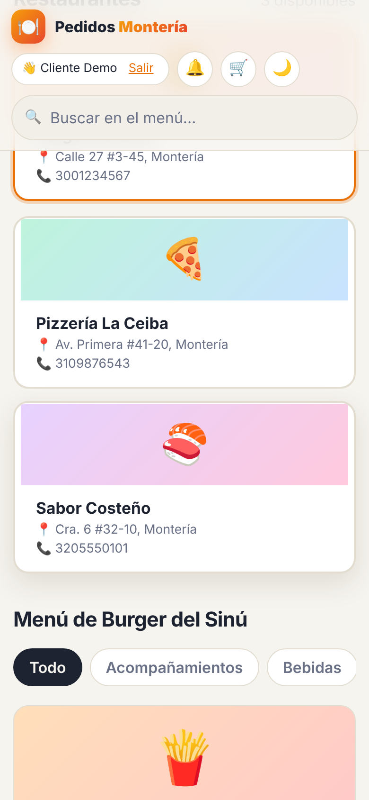
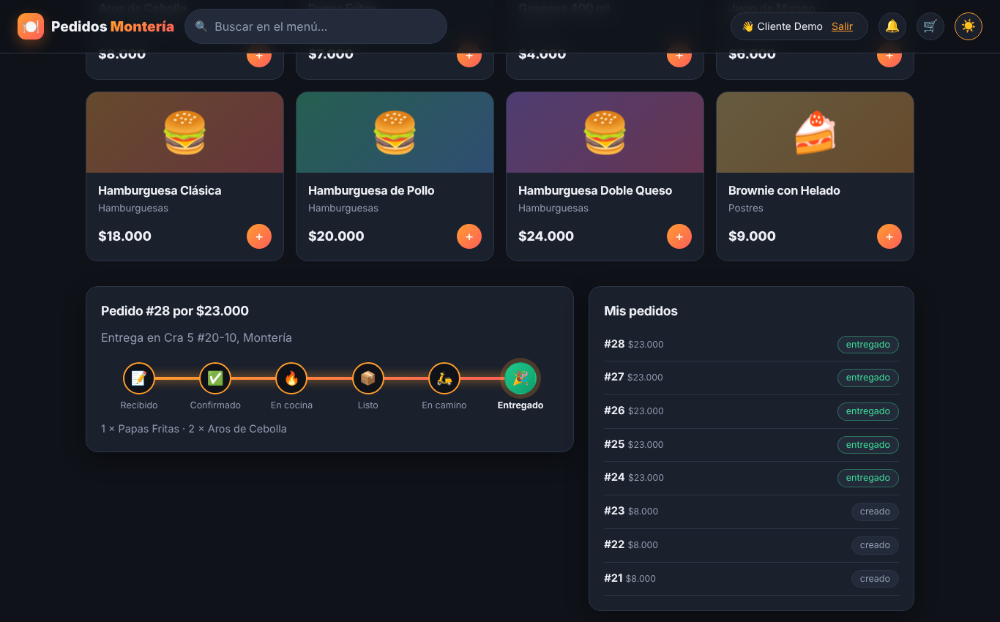

# 06 · Plan y evidencias de pruebas

## Estrategia
| Nivel | Qué valida | Herramienta | Resultado |
|---|---|---|---|
| Unitarias | JWT (vigencia, firma, alteración), roles, clave interna, `X-Request-ID`, métricas, URLs por entorno, publicación con y sin broker, unión de OpenAPI | `pytest` — [`tests/test_unitarias.py`](../tests/test_unitarias.py) | **16 / 16 correctas** ([evidencia](evidencias/pruebas_unitarias_detalle.txt)) |
| Integración (API real + BD real) | Flujo completo, reglas de negocio, seguridad, errores HTTP, concurrencia, monitoreo y documentación | [`probar.py`](../probar.py) | **94 correctas, 0 fallas** ([evidencia](evidencias/pruebas_integracion.txt)) |
| Resiliencia (mensajería) | Idempotencia, DLQ, caída de RabbitMQ, caída del consumidor | [`tests/resiliencia_rabbitmq.py`](../tests/resiliencia_rabbitmq.py) | **9 / 9 correctas** ([evidencia](evidencias/resiliencia_rabbitmq.txt)) |
| Interfaz (navegador real) | Cliente, panel, repartidor, monitor, móvil | Playwright — [`tests/prueba_interfaz.py`](../tests/prueba_interfaz.py) | **12 / 12 correctas** ([evidencia](evidencias/pruebas_interfaz.txt)) |

## Casos de integración destacados
| Caso | Esperado | Resultado |
|---|---|---|
| Login incorrecto, token falso, sin token, `X-Internal-Key` falsa | 401 / sin acceso | ✔ |
| Email repetido en el registro | 409 | ✔ |
| Cliente intenta crear restaurantes, registrar pagos, cambiar estados, ver usuarios | 403 | ✔ |
| Pedido con tarjeta | 201, total calculado por el servidor, stock descontado, pago confirma el pedido | ✔ |
| Cliente intenta falsificar el precio | se ignora | ✔ |
| Stock insuficiente, producto de otro restaurante, dirección vacía | 409 / 400 sin descuentos huérfanos | ✔ |
| Cancelar pedido | stock devuelto, pago `FALLIDO`; no se cancela dos veces (409) | ✔ |
| Otro cliente consulta o cancela pedidos o avisos ajenos | 403 | ✔ |
| Saltar estados; cancelar en cocina o en camino | 409 | ✔ |
| ADMIN intenta fijar `EN_CAMINO` | 403 (solo lo hace el repartidor) | ✔ |
| Nadie disponible al estar `LISTO` | pedido en la bolsa + aviso a repartidores | ✔ |
| Varios repartidores aceptan a la vez | solo el primero se queda el domicilio | ✔ |
| Varios disponibles | se asigna al de menos domicilios; solo a disponibles | ✔ |
| Otro repartidor o un cliente intentan mover un domicilio ajeno | 403 | ✔ |
| Entrega completa | pedido `ENTREGADO`, efectivo `PAGADO`, avisos al cliente | ✔ |
| Restaurante inactivo o producto oculto | no se listan ni se pueden pedir (409) | ✔ |
| `/monitor`, `/metrics` protegidos para ADMIN; `X-Request-ID` por el gateway; cliente no inyecta eventos | ✔ | ✔ |
| Swagger unificado (50+ operaciones, todas con resumen, esquema Bearer) y errores en formato JSON | ✔ | ✔ |

## Evidencias de resiliencia (RabbitMQ)
1. **Idempotencia:** el mismo evento enviado dos veces crea 1 aviso, no 2.
2. **DLQ:** un mensaje no-JSON publicado en el exchange termina en `notificaciones.dlq` y el consumidor sigue procesando.
3. **RabbitMQ caído:** el pedido se crea (201, 0.3 s), el aviso llega por el respaldo HTTP; al volver el broker, el consumidor se reconecta y los eventos regresan a AMQP.
4. **Consumidor caído:** el evento espera en la cola durable (`notificaciones 1`) y se entrega al volver el servicio.

## Capturas de la interfaz
| | |
|---|---|
|  |  |
|  |  |
|  |  |
|  |  |
|  |  |

## Cómo se ejecutó cada prueba
Servicios con usuarios de BD por servicio y RabbitMQ 3.x local, MariaDB local. Comandos en el [README](../README.md#pruebas).

## Limitaciones declaradas
* **Imágenes Docker no construidas en este entorno de trabajo** (el registro de imágenes estaba bloqueado). `docker-compose.yml` fue validado con `docker compose config`, y los mismos servicios se probaron con las mismas variables de entorno (usuarios de BD por servicio, `RABBITMQ_URL`, `*_URL`) directamente con Python. **Haz `docker compose up --build` en tu equipo antes de la sustentación** y corrige cualquier detalle de red/versión que aparezca.
* No hay pruebas de carga ni de seguridad automatizadas (p. ej. OWASP ZAP).
* Los pagos son simulados.
* El historial de Git comienza con la entrega de esta versión; no refleja el desarrollo anterior.
